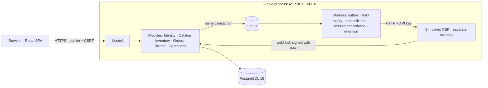

**English** · [Türkçe](README.tr.md)

# Loca — Event Ticket Sales and Gate Control

**Owner / author:** TCoderr
<!-- Kept verbatim because scripts/scan-repo.mjs checks README.md for this exact author line: **Sahip / yazar:** TCoderr -->

A platform that runs end to end locally, where multiple organizers sell events, sessions and tickets; customers buy
seated or general admission tickets; and gate attendants control entry by QR code.

The focus is **correctness**, not screens: the same seat is not sold to two people, inventory is not mishandled while
a payment outcome is uncertain, the same ticket does not pass the gate twice — and these are demonstrated on real
PostgreSQL with concurrent tests whose ordering is forced.

> All people, events and payments are **synthetic** ("Demo"). There is no real payment, email or SMS.
> Durations and cancellation/refund rules are demo assumptions; they are not presented as a legal or industry standard.

## What it does

| Role | What they can do |
|---|---|
| Customer | Discovery (city/category/date), selection from the seating plan or by category, time-limited hold, simulated payment, QR ticket, full cancellation where permitted |
| Organizer | Only their own organization's venues, seating plans, events, sessions, pricing/capacity, gate team, sales summary and operations queue |
| Gate attendant | Online check-in (camera or manual code entry), only for the session they are assigned to |
| Platform administrator | Organization approval, unpublishing, operations queue, audit log, dead-letter, demo PSP panel |

## Architecture (summary)



- **Modular monolith**, a single database, one schema per module. Pure business rules live in `Loca.Domain` (no EF/HTTP dependency).
- **Inventory:** `READ COMMITTED` + `SELECT … FOR UPDATE` in a deterministic order + conditional updates + CHECK/unique constraints.
- **Idempotency:** the record is written in the same transaction as the business effect; the response body is stored as bytes.
- **Payment:** the provider call is made outside the transaction (outbox); the synchronous response, the webhook and reconciliation all go through a single state-application path.
- **Identity:** HttpOnly/Secure cookie + server-side session record (the old cookie is invalid after logout) + CSRF.
- Rationale for the decisions: [`docs/adr/`](docs/adr). Details: [`docs/03-target-architecture.md`](docs/03-target-architecture.md).

## Requirements

| Purpose | Required |
|---|---|
| Running the application | Docker Engine + Compose v2 (Docker Desktop is enough) |
| Smoke test | + Node.js 24 |
| Development / tests | + .NET SDK 10.0.401, Node.js 24 / npm |

On the first build the `postgres:18.6`, `mcr.microsoft.com/dotnet/sdk:10.0.401`, `mcr.microsoft.com/dotnet/aspnet:10.0.12`
and `node:24-alpine` images are pulled. Nothing else is installed on the machine.

## Running

Change to the project root (use quotes if the path contains spaces):

```powershell
# Windows PowerShell
cd "D:\Etkinlik ve Bilet Satış Platformu\event-ticketing-platform"
.\scripts\local-stack.ps1 init      # first-time setup: creates secrets, builds the image, migration + demo data
.\scripts\local-stack.ps1 status    # services and /health/ready
.\scripts\local-stack.ps1 logs      # logs (optional: -Service api)
.\scripts\local-stack.ps1 down      # stop — data and secret files are KEPT
.\scripts\local-stack.ps1 up        # start again
```

```bash
# Linux / macOS / WSL / Git Bash
cd /path/to/event-ticketing-platform
scripts/local-stack.sh init
scripts/local-stack.sh status
scripts/local-stack.sh down
scripts/local-stack.sh up
```

Address: **https://localhost:8643** — the certificate is a self-signed certificate created locally; the browser shows
a warning on first visit (the machine's trust store is not modified). For a different port: `init -HttpsPort 9443`
(`--https-port 9443`).

`init` can be re-run: it does not overwrite existing secret files, and the demo data is idempotent.

### Destructive reset (a separate, explicit command)

```powershell
.\scripts\local-stack.ps1 reset -ConfirmProject loca
```

Deletes the volumes and the `.local/loca/` state directory. It does not run without the confirmation parameter, and
before deleting it verifies that the volume label matches the identity in this stack's manifest.

## Demo users

Passwords are not in the repository; they are created at random during `init` and written to private files **named
after the user name**: `.local/loca/users/<email>.password.txt` (`.local/` is ignored by git).

| User (email) | Role | Password file |
|---|---|---|
| `platform-admin@loca.demo` | Platform administrator | `.local/loca/users/platform-admin@loca.demo.password.txt` |
| `organizer-kumru@loca.demo` | Organizer — Kumru Sahne (Demo) | `.local/loca/users/organizer-kumru@loca.demo.password.txt` |
| `organizer-marti@loca.demo` | Organizer — Martı Etkinlik (Demo) | `.local/loca/users/organizer-marti@loca.demo.password.txt` |
| `gate-kumru@loca.demo` | Gate attendant — Kumru Sahne | `.local/loca/users/gate-kumru@loca.demo.password.txt` |
| `customer-ayse@loca.demo` | Customer | `.local/loca/users/customer-ayse@loca.demo.password.txt` |
| `customer-mehmet@loca.demo` | Customer | `.local/loca/users/customer-mehmet@loca.demo.password.txt` |

To see a password: `Get-Content ".local\loca\users\customer-ayse@loca.demo.password.txt"`.

The demo catalog is dated relative to the moment of seeding: three future-dated sessions, and — for trying out the gate
screen — a "Bu Akşam Stand-up (Demo)" session that is 2 hours away from its start. Once that session has started it no
longer appears in discovery; you can create a new near-term session from the organizer screen.

## Demo walkthrough

Step-by-step scenario (the document is in Turkish): [`docs/portfolio-summary.md`](docs/portfolio-summary.md#demo-yürüyüşü).

## Tests

```powershell
dotnet restore --locked-mode
dotnet build -c Release --no-restore
dotnet test --project tests/Loca.UnitTests -c Release --no-build
dotnet test --project tests/Loca.IntegrationTests -c Release --no-build   # Testcontainers: starts its own PostgreSQL 18.6

cd web
npm ci
npm run typecheck; npm run lint; npm run test; npm run build
npm run e2e            # starts an empty stack dedicated to this run, runs Playwright, deletes the stack
cd ..

node scripts/smoke.mjs --project loca    # HTTPS smoke against the running stack (including restart and DB outage)
node scripts/scan-repo.mjs               # repository secret / author scan
```

- Integration tests do not use SQLite/EF InMemory; they write only to the PostgreSQL container they start themselves
  (the endpoint + the server identity + a marker belonging to the run are verified).
- On the .NET 10 SDK, xUnit v3 runs on Microsoft Testing Platform: the `dotnet test --project <path>` form is used.
- Latest verification results: [`docs/final-verification.md`](docs/final-verification.md). They are local results and belong to the source
  state that was used during that verification, before the repository was pushed (its "remote CI was not run / no push" statements describe
  that moment). Since then commit `05c3901` changed only the executable bit of `scripts/local-stack.sh`, and this README was translated
  (`README.md` in English, Turkish text in `README.tr.md`; the README files are outside the scope of the recorded fingerprint). No local
  re-run of the recorded verification is on record after these changes.
- Remote CI: [run 38181683048](https://github.com/TCoderr/event-ticketing-platform/actions/runs/38181683048) on commit `05c3901` completed
  successfully (backend, web, repository scan and E2E jobs; checked 2026-10-12, UTC+3). The statement is tied to that commit: no result is
  claimed for later commits, including the one that adds this README text. Current state:
  [GitHub Actions](https://github.com/TCoderr/event-ticketing-platform/actions) (definition: [`.github/workflows/ci.yml`](.github/workflows/ci.yml)).

## Repository layout

```
src/Loca.Domain/            Pure business rules (state machines, money, time policies, canonical digest, token, signature)
src/Loca.Api/               ASP.NET Core host: Modules/, Infrastructure/, PspSimulator/
tests/Loca.UnitTests/       Domain and pure helpers
tests/Loca.IntegrationTests/ Real PostgreSQL + real HTTP pipeline
web/                        React SPA, component tests, Playwright E2E
scripts/                    local-stack (ps1/sh), smoke, repository scan
deploy/postgres/init/       Initial setup of the database roles
design/preview.html         Static UI prototype
docs/                       Requirements, domain, architecture, database, API, security, UI, plan, tests, ADRs, reports
```

## Documentation

| Document | Contents |
|---|---|
| [`docs/01-product-requirements.md`](docs/01-product-requirements.md) | Scope, roles, time rules, metric definitions |
| [`docs/02-domain-and-state-machines.md`](docs/02-domain-and-state-machines.md) | Aggregates, lock order, state machines, race scenarios |
| [`docs/03-target-architecture.md`](docs/03-target-architecture.md) | Architecture, modules, transaction ownership, versions |
| [`docs/04-database-design.md`](docs/04-database-design.md) · [`04a`](docs/04a-schema-reference.md) | Schema design, roles, retention; generated schema dump |
| [`docs/05-api-contracts.md`](docs/05-api-contracts.md) · [`05a`](docs/05a-api-operations.md) | API contract; operation list matched against OpenAPI by a test |
| [`docs/06-security-and-failure-behavior.md`](docs/06-security-and-failure-behavior.md) | Identity, authorization matrix, failure behavior |
| [`docs/07-ui-design.md`](docs/07-ui-design.md) | UI identity, screens, accessibility |
| [`docs/09-test-and-verification-plan.md`](docs/09-test-and-verification-plan.md) | Test strategy and invariant → test mapping |
| [`docs/final-verification.md`](docs/final-verification.md) | Commands run, counts, defects found/fixed |
| [`docs/known-limitations.md`](docs/known-limitations.md) | Known limitations and what was not verified |
| [`docs/portfolio-summary.md`](docs/portfolio-summary.md) | Business problem, technical decisions, demo walkthrough |
| [`docs/versions-and-licenses.md`](docs/versions-and-licenses.md) | Versions, their sources and third-party licenses |

## Out of scope

Real PSP / email / SMS, campaigns and coupons, dynamic pricing, waiting room, CAPTCHA, offline check-in,
native mobile app, maps, resale, multiple currencies, payouts/commission/accounting, statutory
invoicing, Kubernetes and cloud deployment, AI/LLM features.
