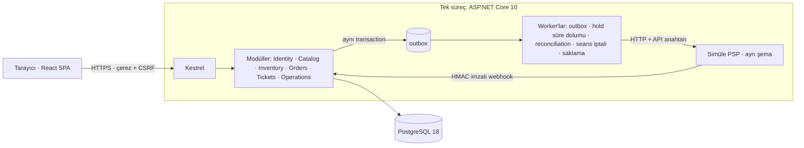

[English](README.md) · **Türkçe**

# Loca — Etkinlik Bileti Satışı ve Kapı Kontrolü

**Sahip / yazar:** TCoderr

Birden çok organizatörün etkinlik, seans ve bilet sattığı; müşterinin koltuk veya genel giriş bileti
aldığı; kapı görevlisinin QR ile giriş kontrolü yaptığı, yerelde uçtan uca çalışan bir platform.

Odak noktası ekran değil **doğruluktur**: aynı koltuk iki kişiye satılmaz, ödeme sonucu belirsizken
envanter yanlış yönetilmez, aynı bilet kapıdan iki kez geçmez — ve bunlar gerçek PostgreSQL üzerinde,
eşzamanlı ve sıralaması zorlanmış testlerle gösterilir.

> Tüm kişiler, etkinlikler ve ödemeler **sentetiktir** ("Demo"). Gerçek ödeme, e-posta veya SMS yoktur.
> Süreler ve iptal/iade kuralları demo varsayımıdır; hukuki veya sektörel standart olarak sunulmaz.

## Ne yapar

| Rol | Yapabildikleri |
|---|---|
| Müşteri | Keşif (şehir/kategori/tarih), koltuk planından veya kategoriden seçim, süreli hold, simüle ödeme, QR bilet, izinli tam iptal |
| Organizatör | Yalnız kendi organizasyonunun mekan, plan, etkinlik, seans, fiyat/kapasite, kapı ekibi, satış özeti ve operasyon kuyruğu |
| Kapı görevlisi | Yalnız atandığı seansta online check-in (kamera veya elle kod) |
| Platform yöneticisi | Organizasyon onayı, yayından kaldırma, operasyon kuyruğu, denetim kaydı, dead-letter, demo PSP paneli |

## Mimari (özet)



- **Modular monolith**, tek veritabanı, modül başına şema. Saf iş kuralları `Loca.Domain` içinde (EF/HTTP bağımlılığı yok).
- **Envanter:** `READ COMMITTED` + deterministik sırada `SELECT … FOR UPDATE` + koşullu güncelleme + CHECK/unique kısıtlar.
- **Idempotency:** kayıt, iş etkisiyle aynı transaction'da; yanıt gövdesi bayt olarak saklanır.
- **Ödeme:** sağlayıcı çağrısı transaction dışında (outbox); senkron yanıt, webhook ve reconciliation tek durum uygulama yolundan geçer.
- **Kimlik:** HttpOnly/Secure çerez + sunucu oturum kaydı (logout sonrası eski çerez geçersiz) + CSRF.
- Kararların gerekçeleri: [`docs/adr/`](docs/adr). Ayrıntı: [`docs/03-target-architecture.md`](docs/03-target-architecture.md).

## Gereksinimler

| Amaç | Gerekli |
|---|---|
| Uygulamayı çalıştırmak | Docker Engine + Compose v2 (Docker Desktop yeterli) |
| Smoke testi | + Node.js 24 |
| Geliştirme / testler | + .NET SDK 10.0.401, Node.js 24 / npm |

İlk derlemede `postgres:18.6`, `mcr.microsoft.com/dotnet/sdk:10.0.401`, `mcr.microsoft.com/dotnet/aspnet:10.0.12`
ve `node:24-alpine` imajları çekilir. Makineye başka bir şey kurulmaz.

## Çalıştırma

Proje köküne geçin (yol boşluk içeriyorsa tırnak kullanın):

```powershell
# Windows PowerShell
cd "D:\Etkinlik ve Bilet Satış Platformu\event-ticketing-platform"
.\scripts\local-stack.ps1 init      # ilk kurulum: secret üretir, imajı derler, migration + demo verisi
.\scripts\local-stack.ps1 status    # servisler ve /health/ready
.\scripts\local-stack.ps1 logs      # loglar (isteğe bağlı: -Service api)
.\scripts\local-stack.ps1 down      # durdur — veri ve secret dosyaları KORUNUR
.\scripts\local-stack.ps1 up        # yeniden aç
```

```bash
# Linux / macOS / WSL / Git Bash
cd /yol/event-ticketing-platform
scripts/local-stack.sh init
scripts/local-stack.sh status
scripts/local-stack.sh down
scripts/local-stack.sh up
```

Adres: **https://localhost:8643** — sertifika yerelde üretilen self-signed sertifikadır; tarayıcı ilk
açılışta uyarı gösterir (makinenin güven deposu değiştirilmez). Farklı port için: `init -HttpsPort 9443`
(`--https-port 9443`).

`init` tekrar çalıştırılabilir: var olan secret dosyalarının üzerine yazmaz, demo verisi idempotenttir.

### Yıkıcı sıfırlama (ayrı ve açık komut)

```powershell
.\scripts\local-stack.ps1 reset -ConfirmProject loca
```

Volume'ları ve `.local/loca/` durum dizinini siler. Onay parametresi olmadan çalışmaz ve silmeden önce
volume etiketinin bu stack'in manifestindeki kimlikle eşleştiğini doğrular.

## Demo kullanıcıları

Parolalar depoda yoktur; `init` sırasında rastgele üretilir ve **kullanıcı adıyla aynı adı taşıyan**
özel dosyalara yazılır: `.local/loca/users/<e-posta>.password.txt` (`.local/` git tarafından yok sayılır).

| Kullanıcı (e-posta) | Rol | Parola dosyası |
|---|---|---|
| `platform-admin@loca.demo` | Platform yöneticisi | `.local/loca/users/platform-admin@loca.demo.password.txt` |
| `organizer-kumru@loca.demo` | Organizatör — Kumru Sahne (Demo) | `.local/loca/users/organizer-kumru@loca.demo.password.txt` |
| `organizer-marti@loca.demo` | Organizatör — Martı Etkinlik (Demo) | `.local/loca/users/organizer-marti@loca.demo.password.txt` |
| `gate-kumru@loca.demo` | Kapı görevlisi — Kumru Sahne | `.local/loca/users/gate-kumru@loca.demo.password.txt` |
| `customer-ayse@loca.demo` | Müşteri | `.local/loca/users/customer-ayse@loca.demo.password.txt` |
| `customer-mehmet@loca.demo` | Müşteri | `.local/loca/users/customer-mehmet@loca.demo.password.txt` |

Parolayı görmek için: `Get-Content ".local\loca\users\customer-ayse@loca.demo.password.txt"`.

Demo kataloğu seed anına göre tarihlenir: üç gelecek tarihli seans ve kapı ekranını denemek için
başlangıcına 2 saat kalan bir "Bu Akşam Stand-up (Demo)" seansı. Bu seans başladıktan sonra keşifte
görünmez; yeni bir yakın seansı organizatör ekranından oluşturabilirsiniz.

## Demo yürüyüşü

Adım adım senaryo: [`docs/portfolio-summary.md`](docs/portfolio-summary.md#demo-yürüyüşü).

## Testler

```powershell
dotnet restore --locked-mode
dotnet build -c Release --no-restore
dotnet test --project tests/Loca.UnitTests -c Release --no-build
dotnet test --project tests/Loca.IntegrationTests -c Release --no-build   # Testcontainers: kendi PostgreSQL 18.6'sını açar

cd web
npm ci
npm run typecheck; npm run lint; npm run test; npm run build
npm run e2e            # bu koşuya özel boş bir stack açar, Playwright'ı çalıştırır, stack'i siler
cd ..

node scripts/smoke.mjs --project loca    # çalışan stack'e HTTPS smoke (restart ve DB kesintisi dahil)
node scripts/scan-repo.mjs               # depo secret / yazar taraması
```

- Entegrasyon testleri SQLite/EF InMemory kullanmaz; yalnız kendi başlattıkları PostgreSQL konteynerine yazar
  (uç nokta + sunucu kimliği + koşuya ait işaret doğrulanır).
- .NET 10 SDK'da xUnit v3, Microsoft Testing Platform ile çalışır: `dotnet test --project <yol>` biçimi kullanılır.
- Son doğrulama sonuçları: [`docs/final-verification.md`](docs/final-verification.md). Bunlar yerel sonuçlardır; depo push edilmeden önce,
  o doğrulama sırasında kullanılan kaynak durumuna aittir (belgedeki "uzak CI çalıştırılmadı / push yok" ifadeleri o ana aittir). Sonrasında
  `05c3901` commit'i yalnız `scripts/local-stack.sh` dosyasının çalıştırma iznini değiştirdi ve bu README İngilizceye çevrildi (`README.md`
  İngilizce, Türkçe metin `README.tr.md`; README dosyaları kayıtlı parmak izinin kapsamında değildir). Bu değişikliklerden sonra kayıtlı
  doğrulamanın yerelde yeniden koşulduğuna dair bir kayıt yoktur.
- Uzak CI: `05c3901` commit'i için [koşu 38181683048](https://github.com/TCoderr/event-ticketing-platform/actions/runs/38181683048) başarıyla
  tamamlandı (backend, web, depo taraması ve E2E işleri; 2026-10-12, UTC+3 tarihinde kontrol edildi). Bu ifade yalnız o commit'e bağlıdır:
  bu README metnini ekleyen commit dahil sonraki commit'ler için bir sonuç iddia edilmez. Güncel durum:
  [GitHub Actions](https://github.com/TCoderr/event-ticketing-platform/actions) (tanım: [`.github/workflows/ci.yml`](.github/workflows/ci.yml)).

## Depo düzeni

```
src/Loca.Domain/            Saf iş kuralları (durum makineleri, para, zaman politikaları, kanonik özet, token, imza)
src/Loca.Api/               ASP.NET Core host: Modules/, Infrastructure/, PspSimulator/
tests/Loca.UnitTests/       Domain ve saf yardımcılar
tests/Loca.IntegrationTests/ Gerçek PostgreSQL + gerçek HTTP hattı
web/                        React SPA, bileşen testleri, Playwright E2E
scripts/                    local-stack (ps1/sh), smoke, depo taraması
deploy/postgres/init/       Veritabanı rollerinin ilk kurulumu
design/preview.html         Statik arayüz prototipi
docs/                       Gereksinim, domain, mimari, veritabanı, API, güvenlik, arayüz, plan, test, ADR'ler, raporlar
```

## Belgeler

| Belge | İçerik |
|---|---|
| [`docs/01-product-requirements.md`](docs/01-product-requirements.md) | Kapsam, roller, zaman kuralları, metrik tanımları |
| [`docs/02-domain-and-state-machines.md`](docs/02-domain-and-state-machines.md) | Aggregate'ler, kilit sırası, durum makineleri, yarış senaryoları |
| [`docs/03-target-architecture.md`](docs/03-target-architecture.md) | Mimari, modüller, transaction sahipliği, sürümler |
| [`docs/04-database-design.md`](docs/04-database-design.md) · [`04a`](docs/04a-schema-reference.md) | Şema tasarımı, roller, saklama; üretilmiş şema dökümü |
| [`docs/05-api-contracts.md`](docs/05-api-contracts.md) · [`05a`](docs/05a-api-operations.md) | API sözleşmesi; OpenAPI ile testle eşlenen operasyon listesi |
| [`docs/06-security-and-failure-behavior.md`](docs/06-security-and-failure-behavior.md) | Kimlik, yetki matrisi, hata davranışı |
| [`docs/07-ui-design.md`](docs/07-ui-design.md) | Arayüz kimliği, ekranlar, erişilebilirlik |
| [`docs/09-test-and-verification-plan.md`](docs/09-test-and-verification-plan.md) | Test stratejisi ve invariant → test eşlemesi |
| [`docs/final-verification.md`](docs/final-verification.md) | Çalıştırılan komutlar, sayılar, bulunan/düzeltilen kusurlar |
| [`docs/known-limitations.md`](docs/known-limitations.md) | Bilinen sınırlar ve doğrulanmayanlar |
| [`docs/portfolio-summary.md`](docs/portfolio-summary.md) | İş problemi, teknik kararlar, demo yürüyüşü |
| [`docs/versions-and-licenses.md`](docs/versions-and-licenses.md) | Sürümler, kaynakları ve üçüncü taraf lisansları |

## Kapsam dışı

Gerçek PSP / e-posta / SMS, kampanya-kupon, dinamik fiyat, bekleme odası, CAPTCHA, offline check-in,
native mobil uygulama, harita, yeniden satış, çoklu para birimi, hakediş/komisyon/muhasebe, yasal
fatura, Kubernetes ve bulut dağıtımı, AI/LLM özelliği.
