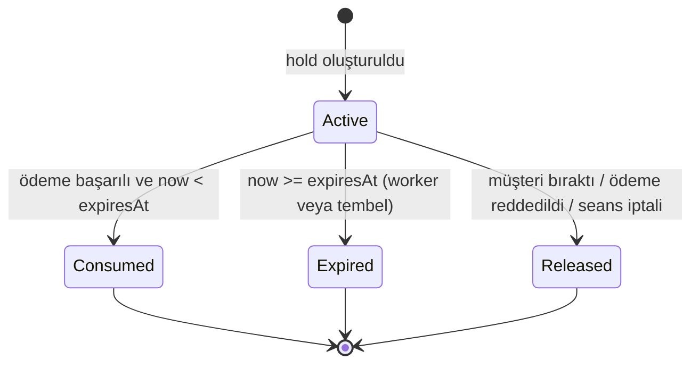
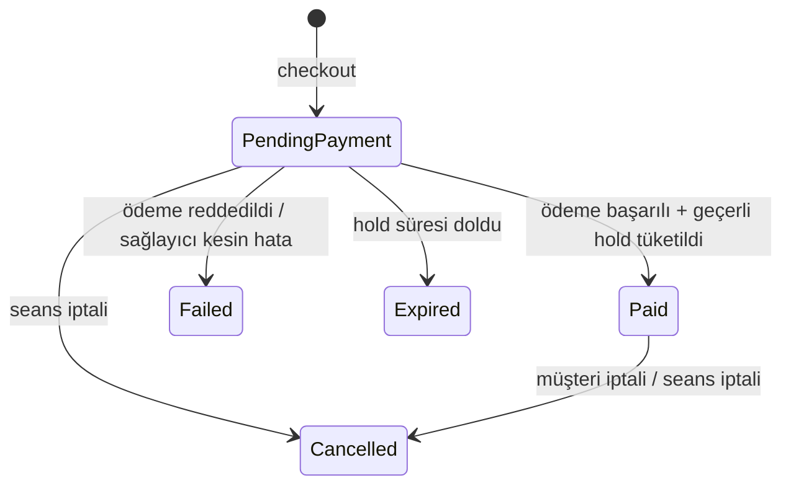
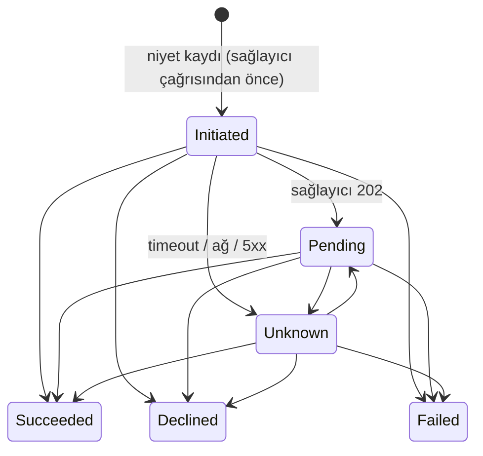
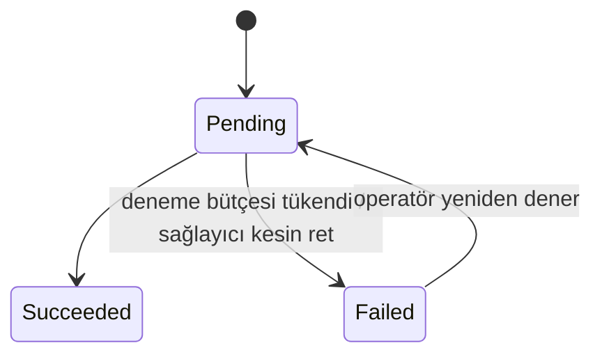
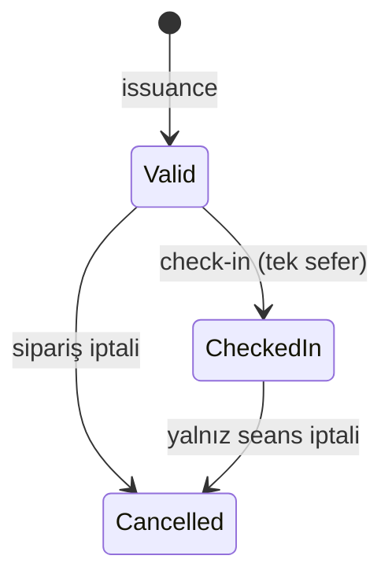

# 02 — Domain ve Durum Makineleri

## 1. Aggregate'ler ve kilit kökleri

| Aggregate | Kök satır | İçerdiği |
|---|---|---|
| Reservation kümesi | `inventory.reservations` | satırlar, sipariş, ödeme, iade, biletler |
| Session | `catalog.sessions` | koltuk envanteri (`session_seats`), GA kategorileri |
| Event | `catalog.events` | — |
| Organization | `identity.organizations` | üyeler |

**Tek kilit kökü kuralı:** Bir siparişin yaşam döngüsünü değiştiren her işlem (ödeme sonucu, süre
dolumu, iptal, check-in, bilet üretimi) önce `reservations` satırını `FOR UPDATE` ile kilitler.
İptal ile check-in, ödeme ile süre dolumu bu sayede aynı kilit üzerinde yarışır.

**Global kilit sırası** (deadlock'ı önlemek için her transaction bu sıraya uyar):

```
1. reservations (tek satır; kök)
2. sessions     (FOR SHARE; yalnız seans iptali/düzenlemesi FOR UPDATE alır)
3. session_seats / ga_categories  (id'ye göre artan sırada)
4. tickets      (id'ye göre artan sırada)
```

Hold oluşturma `2 → 3` alır (yeni rezervasyon satırı henüz kimse tarafından görülemez). GA'da süresi
dolmuş başka hold'ları toplarken (reap) 3'ten sonra başka `reservations` satırlarına yalnız
`FOR UPDATE SKIP LOCKED` ile dokunulur; beklemediği için sıra ihlali deadlock üretmez.

## 2. Durum makineleri

### 2.1 Reservation (hold)



Guard'lar: `Consumed` yalnız `status = Active AND now < expires_at` iken ve tüm koltuklar hâlâ bu
hold'a aitken mümkündür. Üç son durum da terminaldir; hiçbiri envanteri yeniden ele geçirmez.

### 2.2 Order



`Expired`, `Failed`, `Cancelled` terminaldir. Bu durumlardaki siparişe geç gelen ödeme başarısı
siparişi **yeniden `Paid` yapmaz**; telafi iadesi üretir.

### 2.3 Payment



- `Declined` (kart/işlem reddi) ile `Failed` (sağlayıcı hatası, `ProviderError`) ayrı durum ve ayrı nedendir.
- `Unknown` ret değildir; yalnız sağlayıcıya sorgu (reconciliation) veya webhook ile çözülür.
- Sağlayıcı olayları ödeme başına artan `sequence` taşır; `sequence <= last_provider_sequence` olan olay
  durum değiştirmez (sırasız callback koruması).
- Terminal: `Succeeded`, `Declined`, `Failed`.

### 2.4 Refund



Ödeme başına tek iade (tam tutar). Neden: `CustomerCancellation | SessionCancellation | LatePaymentCompensation`.

### 2.5 Ticket



Bilet, sipariş iptalinin commit'i ile aynı anda `Cancelled` olur; iadenin `Pending` veya `Failed`
olması bileti geçerli kılmaz.

### 2.6 Session / Event / Organization

- Session: `Draft → Published → Cancelled`, `Draft → Cancelled`. `Cancelled` terminaldir.
- Event: `Draft ⇄ Published`, `→ Cancelled`. Rezervasyonu olan seansı bulunan etkinlik `Draft`'a dönemez.
- Organization: `PendingApproval → Active ⇄ Suspended`.

## 3. Envanterin yeniden açılma anı

| Olay | Envanter |
|---|---|
| Hold `Expired` / `Released` | Aynı transaction'da açılır |
| Ödeme reddi | Hold `Released`, aynı transaction'da açılır |
| Müşteri iptali (Paid) | İptal transaction'ında açılır (bilet aynı anda geçersiz); iade sonucunu beklemez |
| Seans iptali | **Açılmaz** — iptal edilen seans satışa dönmez |
| Geç başarı | Açılacak bir şey yok; envanter zaten serbest ya da başkasında |

## 4. Örnek akışlar

### 4.1 Ödeme başarısı ile süre dolumu yarışı

Her iki taraf da önce `reservations` satırını kilitler; kazanan sırayı belirler.

**Sıra A — ödeme önce:**

```mermaid
sequenceDiagram
    participant P as ApplyPaymentSuccess
    participant DB
    participant W as ExpiryWorker
    P->>DB: BEGIN; SELECT reservation FOR UPDATE
    W->>DB: BEGIN; SELECT ... FOR UPDATE SKIP LOCKED (satır kilitli → atlanır)
    P->>DB: now < expires_at ✔; koltuk Held→Sold; reservation=Consumed; order=Paid; outbox(order.paid)
    P->>DB: COMMIT
    W->>DB: sonraki tur: status != Active → iş yok
```

Sonuç: `Paid`, biletler üretilir, envanter `Sold`. Sonradan gelen süre dolumu satılmış envanteri açmaz.

**Sıra B — süre dolumu önce:**

```mermaid
sequenceDiagram
    participant W as ExpiryWorker
    participant DB
    participant P as ApplyPaymentSuccess
    W->>DB: BEGIN; reservation FOR UPDATE; koltuklar serbest; reservation=Expired; order=Expired; COMMIT
    P->>DB: BEGIN; SELECT reservation FOR UPDATE
    P->>DB: reservation != Active → geç başarı
    P->>DB: payment=Succeeded; refund(Pending, LatePaymentCompensation); outbox(refund.requested); audit
    P->>DB: COMMIT
```

Sonuç: Sipariş `Expired` kalır, koltuk yeniden kapılmaz, bilet üretilmez, **tek** iade kaydı oluşur
(`refunds.payment_id` unique).

Worker gecikmişse de sonuç aynıdır: `ApplyPaymentSuccess` kilidi aldığında `now >= expires_at` görürse
hold'u kendisi `Expired` yapar, envanteri serbest bırakır ve telafi yoluna girer.

### 4.2 İptal ile check-in yarışı

**Sıra A — check-in önce:** check-in kilidi alır, bilet `CheckedIn`. İptal kilidi aldığında
"kullanılmış bilet var" guard'ı nedeniyle `409 order_has_checked_in_ticket` döner; iade oluşmaz.

**Sıra B — iptal önce:** iptal kilidi alır; sipariş `Cancelled`, biletler `Cancelled`, iade `Pending`.
Check-in kilidi aldığında bilet `Cancelled` görür → `409 ticket_void`. Kabul edilmiş giriş oluşmaz.

Hiçbir sırada hem kabul edilmiş check-in hem de izin dışı iade oluşmaz.

### 4.3 Aynı hold, farklı Idempotency-Key ile checkout

| Adım | İstek | Sonuç |
|---|---|---|
| 1 | `POST /holds/H/checkout`, key=K1 | reservation kilitlenir, order O1 + payment P1 yazılır, `202` (K1 için saklanır) |
| 2 | Aynı istek, key=K1 | Saklanan yanıt bayt bayt döner, `Idempotent-Replayed: true` |
| 3 | Aynı istek, key=K2 | reservation kilidi altında O1 görülür → `409 order_already_exists`, `orderId=O1` |
| 4 | Kilit atlanarak doğrudan INSERT (test) | `orders.reservation_id` unique ihlali (`23505`) |

Taşıma düzeyi idempotency (adım 2) iş düzeyi tekilliğin (adım 3–4) yerine geçmez; ikisi de vardır.

### 4.4 Seans iptali (kalıcı toplu iş)

1. `sessions` satırı `FOR UPDATE`; `status=Cancelled`; `session_cancellation_jobs` satırı; audit. Commit.
2. Worker işi kiralar (lease + fencing token). Sipariş başına ayrı transaction: reservation kilidi →
   sipariş `Cancelled`, biletler `Cancelled`, `Paid` ise iade `Pending` + outbox, imleç (`cursor`) ilerler.
3. Worker çökerse lease süresi dolar; yeni sahip imleçten devam eder. Her sipariş adımı durum
   kontrollü olduğundan yeniden işlenmesi ikinci etki üretmez.

## 5. Değer nesneleri ve kurallar (Domain katmanı)

- `Money`: `long` minor unit + `"TRY"`; negatif olamaz; toplama taşma kontrollü; başka para birimi reddedilir.
- `HoldPolicy`: bilet sayısı 1–6; TTL sınırları; `IsActive(now, expiresAt) = now < expiresAt`.
- `SalesWindow`, `CancellationPolicy`, `CheckInWindow`: §01-4'teki kuralların saf fonksiyonları.
- Durum makinesi geçiş tabloları (`CanTransition(from, to)`) saf koddur; HTTP/EF bağımlılığı yoktur.
- `LocalTime → UTC` dönüşümü: geçersiz (DST boşluğu) ve belirsiz (DST çakışması) yerel saatler reddedilir.
