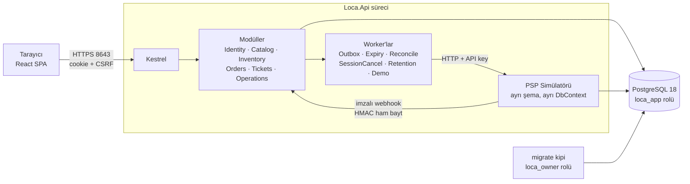
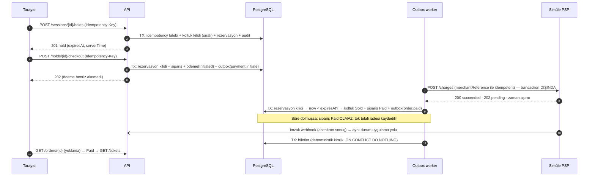

# 03 — Hedef Mimari

## 1. Genel görünüm

ASP.NET Core 10 **modular monolith** + PostgreSQL 18 + aynı origin'den sunulan React/TypeScript SPA.
Tek süreç hem HTTP API'yi hem arka plan worker'larını barındırır. Tek konteyner imajı üç kipte çalışır:
`serve` (varsayılan), `migrate`, `seed-demo`.



## 2. Kod organizasyonu

```
src/Loca.Domain/            Saf iş kuralları: Money, durum makineleri, zaman politikaları, canonical hash
src/Loca.Api/
  Modules/<Modül>/          Endpoint'ler + kullanım senaryosu handler'ları + EF eşlemesi
  Infrastructure/           DbContext, idempotency, outbox/inbox, saat, auth, rate limit, metrikler
  PspSimulator/             Simüle sağlayıcı (kendi DbContext'i ve şeması)
tests/Loca.UnitTests/       Domain + saf altyapı
tests/Loca.IntegrationTests/ Gerçek PostgreSQL (Testcontainers) + WebApplicationFactory
web/                        React SPA, bileşen testleri, Playwright E2E
```

- **İki üretim assembly'si.** `Loca.Domain` hiçbir EF/ASP.NET paketine referans vermez (proje
  referansı ile zorlanır). Application ve Infrastructure ayrımı `Loca.Api` içinde klasör/namespace
  düzeyindedir; ayrı assembly'ye bölmek bu boyutta yalnız tören üretirdi.
- Modüller arası erişim: Bir modül başka modülün tablolarına yalnız o modülün **sahip olduğu servis**
  üzerinden yazar (ör. envanteri yalnız `InventoryService` değiştirir; sipariş modülü koltuğa doğrudan
  `UPDATE` atmaz). Okuma sorguları (özet/rapor) şemalar arası join yapabilir.
- CQRS: komut ve sorgu handler'ları ayrı sınıflardır. MediatR, generic repository yok.

### Transaction sahipliği

| İşlem | Transaction sahibi | Kapsadığı modüller |
|---|---|---|
| Hold oluştur / bırak / süre dolumu | Inventory | Inventory, Operations(audit, idempotency) |
| Checkout | Orders | Orders, Inventory(okuma+kilit), Operations |
| Ödeme sonucunu uygula | Orders | Orders, Inventory(tüketim/serbest bırakma), Operations(outbox, inbox) |
| Bilet üret | Tickets | Tickets, Orders(okuma) |
| Check-in | Tickets | Tickets, Operations |
| İptal (müşteri / seans) | Orders | Orders, Tickets(geçersiz kılma), Inventory(yeniden açma), Operations |

Tek `AppDbContext` kullanıldığı için bu transaction'lar tek veritabanı transaction'ıdır. Sağlayıcı
(PSP) çağrıları **hiçbir zaman** veritabanı transaction'ı içinde yapılmaz; yalnız outbox handler'larında.

## 3. Teknoloji kararları

Her karar için ADR: `docs/adr/`.

| Karar | Seçim | Daha basit alternatif | Maliyet | Ne zaman değişir |
|---|---|---|---|---|
| Mimari | Modular monolith | — | Modül sınırı disiplin gerektirir | Bağımsız ölçek/ekip ihtiyacı |
| Veri | PostgreSQL 18, EF Core 10, tek DbContext, modül şemaları | Modül başına DbContext | Sınır derleyiciyle zorlanmaz | Modül ayrı servise çıkarsa |
| Eşzamanlılık | `READ COMMITTED` + sıralı `SELECT … FOR UPDATE` + koşullu `UPDATE` + CHECK/unique | Yalnız optimistic concurrency | Dar yerde elle SQL | Kilit bekleme ölçümle darboğaz olursa |
| Mesajlaşma | DB outbox/inbox + in-process handler | Senkron çağrı | En az bir kez teslim; handler idempotent olmalı | Harici tüketici / yüksek hacim |
| Kimlik | ASP.NET Core Identity (yalnız kullanıcı deposu) + HttpOnly Secure cookie + CSRF + sunucu oturum kaydı | Yalnız cookie | İstek başına 1 oturum sorgusu | Üçüncü taraf istemci gerekirse OIDC |
| Saat | Veritabanı saati (`clock_timestamp()`), `IClock` arkasında | Uygulama saati | Komut başına 1 küçük sorgu | — |
| TLS | Kestrel doğrudan HTTPS, yerel self-signed sertifika | Reverse proxy (Caddy) | Tarayıcıda güven uyarısı | Proxy/CDN arkasına alınırsa |
| PSP | Aynı süreçte, ayrı şema/DbContext, yalnız HTTP + webhook | Bellek içi mock | İkinci migration seti | Gerçek PSP entegrasyonu |
| Realtime | Polling + otoriter HTTP yenileme | SignalR | Birkaç saniyelik gecikme | Ölçülen ihtiyaç |
| Frontend | React 19, Vite, TanStack Query, elle yazılmış CSS | UI kit | Bileşenler elle | — |

Eklenmeyenler ve nedeni: Redis, RabbitMQ/Kafka, mikroservis, Dapper, MediatR, JWT/OIDC, SignalR —
bu kapsamda somut ihtiyaç yok; her biri işletim ve hata yüzeyi ekler.

## 4. Sürümler (üretici kaynaklarından doğrulandı, 2026-10-10)

| Bileşen | Sürüm | Kaynak |
|---|---|---|
| .NET SDK / runtime | 10.0.401 / 10.0.12 (LTS) | yerel `dotnet --list-sdks`, NuGet |
| EF Core, Identity, OpenAPI, Mvc.Testing | 10.0.12 | api.nuget.org |
| Npgsql.EntityFrameworkCore.PostgreSQL | 10.0.3 | api.nuget.org |
| EFCore.NamingConventions | 10.0.1 | api.nuget.org |
| Testcontainers.PostgreSql | 4.16.0 | api.nuget.org |
| xunit.v3 / runner.visualstudio / Test SDK | 4.0.2 / 4.0.1 / 18.10.1 | api.nuget.org |
| PostgreSQL | 18.6 | Docker Hub resmi imaj (yerelde mevcut) |
| Node.js / npm | 24.18.0 / 12.1.0 | yerel |
| React / Vite / TanStack Query | 19.3.0 / 8.3.4 / 5.104.1 | npm registry |
| TypeScript | 6.0.3 | npm; 7.x `typescript-eslint` peer aralığı (`<6.1.0`) dışında |
| ESLint | 9.39.5 | npm; `eslint-plugin-jsx-a11y` peer aralığı `^9` |
| Playwright | 1.63.0 | npm; yerel önbellekteki Chromium 1243 ile eşleşir |

Restore lock dosyalarıyla yapılır (`packages.lock.json`, `package-lock.json`). Görev sırasında paket
yükseltmesi yapılmaz.

## 5. Worker'lar

Her worker, bir `IBatchProcessor`'ı döngüde çalıştıran `ProcessorWorker<T>` barındırılan servisidir; her tur
kendi DI kapsamındadır. Testlerde worker'lar kapalıdır ve işlemciler doğrudan, deterministik olarak çağrılır.

| İşlemci | İş | Sahiplenme |
|---|---|---|
| `OutboxProcessor` | `outbox_messages` → süreç içi handler (`payment.initiate`, `order.paid`, `refund.requested`) | Lease sütunları + fencing token; sınırlı deneme, dead-letter |
| `HoldExpiryProcessor` | Süresi dolmuş hold'ları kapatır | Tek transaction içinde `FOR UPDATE SKIP LOCKED` |
| `PaymentReconciliationProcessor` | `Initiated`/`Pending`/`Unknown` ödemeleri sağlayıcıdan sorgular | Lease + fencing; bütçe bitince operatöre kalır |
| `SessionCancellationProcessor` | Seans iptal işlerini rezervasyon rezervasyon yürütür | Lease + fencing + imleç (aynı transaction'da) |
| `RetentionProcessor` | Süresi dolmuş idempotency / inbox / outbox / oturum kayıtlarını siler | Tek ifadeli silmeler |
| `DemoCrowdProcessor` | Opt-in seanslarda sentetik alım (normal hold + checkout yolu) | Yalnız `Demo:SimulatorEnabled` ve `Demo:Crowd:Enabled` |
| `PspSimProcessor` | Simülatör: bekleyen tahsilatları sonuçlandırır, webhook teslim eder | Simülatör şeması içinde |

Commit sonrası ilgili worker süreç içi sinyalle (`WorkerSignal<T>`) uyandırılır; sinyal kaybolsa da yoklama
aralığı işi alır. Tüm worker'lar `CancellationToken` ile durur (`HostOptions.ShutdownTimeout` = 20 sn); yarım
kalan iş ya transaction rollback'i ya da lease süresinin dolmasıyla devralınır. Kritik etki için fire-and-forget yoktur.

### Süreç kipleri

`dotnet Loca.Api.dll` → `serve` (varsayılan) · `migrate` (şema sahibi rolüyle migration + yetki eşitleme) ·
`seed-demo` (yalnız `Demo:SeedEnabled=true`) · `healthcheck` (konteyner sağlık denetimi).

### Kritik akış: satın alma



## 6. Tek / çok örnek (instance)

Tasarım çok örnekli çalışmaya uygundur (tüm koordinasyon veritabanında: satır kilitleri, lease,
unique kısıtlar; saat veritabanından). **Doğrulanan** yalnız tek örnekli Compose çalışması ve aynı
veritabanına karşı eşzamanlı worker/istek testleridir; çok örnekli dağıtım denenmemiştir
(`known-limitations.md`).
